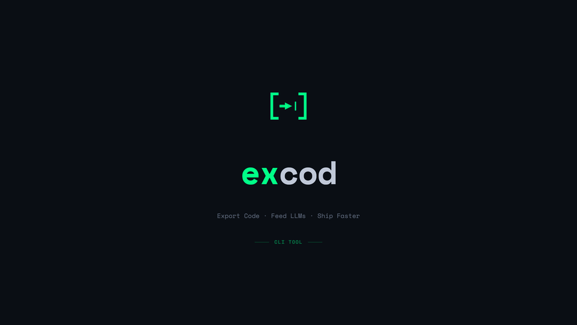

<p align="center">
  
</p>

<br />

**ex·cod** ( **/ˈɛks.kɒd/** ) — **EX**port **COD**e.

Scan a codebase, pick the important files, and export their full contents as a single JSON object — ready for project analysis, code review, or sharing.

## Installation

```bash
npm install -g @subhan-f/excod
```

## Usage

```bash
# Scan current directory, print JSON to terminal
excod

# Scan a specific path
excod ~/projects/my-app

# Save to a file
excod . -o context.json

# Copy directly to clipboard (macOS / Windows / Linux)
excod . --clipboard

# Show help
excod --help
```

## Output format

Each key is a relative file path, each value is the file's full content:

```json
{
  "src/cli.ts": "import { Command } from 'commander';\n...",
  "src/utils.ts": "import { resolve, extname } from 'path';\n...",
  "package.json": "{\n  \"name\": \"@subhan-f/excod\",\n  ...",
  "README.md": "# excod\n..."
}
```

## Options

| Flag                  | Description                      |
| --------------------- | -------------------------------- |
| `[directory]`         | Directory to scan (default: `.`) |
| `-o, --output <path>` | Write JSON to a file             |
| `-c, --clipboard`     | Copy JSON to clipboard           |
| `-V, --version`       | Print version number             |
| `-h, --help`          | Display help                     |

## What gets included

**Included extensions:**
`.ts` `.tsx` `.js` `.jsx` `.py` `.rb` `.go` `.rs` `.java` `.kt` `.aidl` `.gradle` `.kts` `.pro` `.properties` `.xml` `.c` `.cpp` `.h` `.hpp` `.cs` `.json` `.yaml` `.yml` `.toml` `.md` `.txt` `.css` `.scss` `.html` `.vue` `.svelte`

**Always excluded:**
`node_modules/`, `.git/`, `dist/`, `build/`, `__pycache__/`, hidden directories

**Respects `.gitignore` automatically.**

## Why

- **Project analysis** — export the relevant parts of a repository as one compact JSON file
- **Code reviews** — capture a project snapshot without zipping the whole repo
- **Onboarding** — give new teammates a compact map of what matters
- **Android projects** — include Java and Kotlin source, Gradle build files, manifests, resources, and configuration
- **Language-agnostic** — works on any project; no parsing, just file extension matching

## Development

```bash
npm run dev        # run via tsx without building
npm run build      # compile TypeScript → dist/
npm test           # Vitest test suite
npm run lint       # ESLint
npm run format     # Prettier
```

## Requirements

Node.js 18 or higher.
